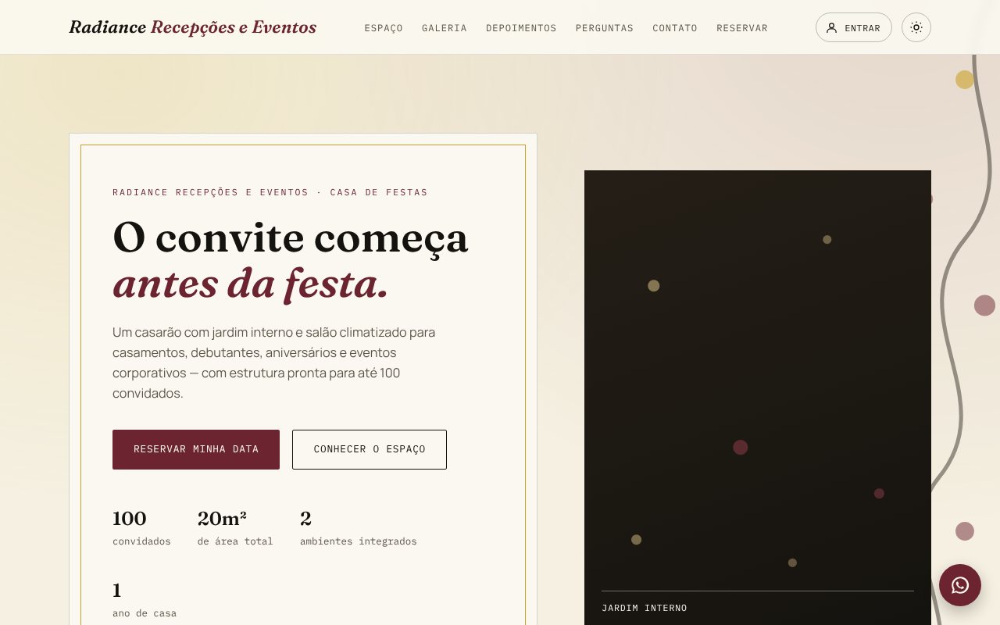
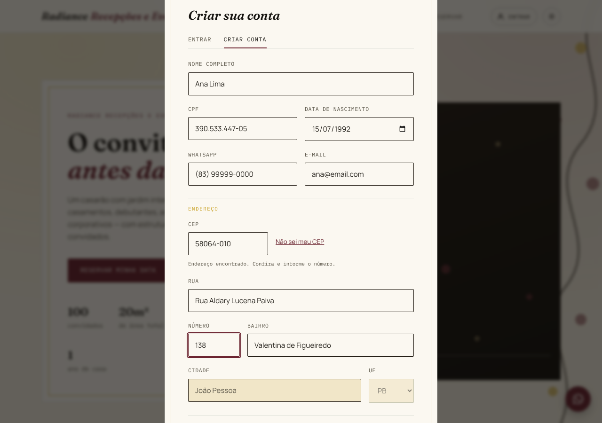

<div align="center">

# Radiance Recepções e Eventos

**Site da casa de festas Radiance, em João Pessoa/PB, com calendário de disponibilidade, pedido de reserva on-line e área do cliente.**




</div>

---

## Sobre

A Radiance é uma casa de festas para casamentos, debutantes, aniversários e eventos corporativos. O site apresenta o espaço e permite que o cliente:

1. veja no calendário quais datas estão livres;
2. crie uma conta, com confirmação do e-mail por código;
3. envie o pedido de reserva, que entra no banco como **pendente** para a equipe confirmar pelo WhatsApp.

## Funcionalidades

**Site**

- Página inicial com o espaço, a estrutura, a galeria, o passo a passo da reserva, depoimentos, perguntas frequentes e contato.
- Página de reserva separada, com prévia do pedido em tempo real.
- Modo claro e escuro, com a escolha salva no navegador.
- Layout responsivo, do celular ao desktop.
- Botão flutuante do WhatsApp.

**Reserva**

- Calendário próprio que marca as datas já ocupadas.
- Eventos de **um dia** (turno diurno ou noturno) ou de **vários dias seguidos**.
- Nome e WhatsApp preenchidos com os dados da conta.
- Se a data for ocupada enquanto o cliente preenche, o site avisa e atualiza o calendário.

**Conta do cliente**

- Cadastro com validação de CPF, maioridade (18+), telefone e e-mail.
- **CEP com preenchimento automático** do endereço (via [ViaCEP](https://viacep.com.br)).
- **Confirmação do e-mail por código de 6 números**, que vale 10 minutos e aceita até 5 tentativas, com reenvio.
- Máscaras de CPF, telefone e CEP que deixam editar qualquer parte do número.
- Login com a sessão mantida entre as páginas.

**Segurança no back-end**

- Senhas guardadas só como hash. O código de verificação é guardado como HMAC, nunca em texto.
- Cookie de sessão `HttpOnly` e `SameSite=Lax`, e a API só aceita JSON (proteção contra CSRF).
- Mensagem de login genérica e bloqueio depois de várias tentativas erradas.
- Toda validação do site é refeita no servidor.
- O banco impede, por trigger, duas reservas confirmadas na mesma data.

## Telas

| Pedido de reserva | Cadastro com CEP automático |
|---|---|
|  |  |
| **Confirmação do e-mail** | **Modo escuro** |
|  |  |

<p align="center"></p>

## Tecnologias

| Parte | Tecnologia |
|---|---|
| Front-end | HTML5, CSS3 e JavaScript puro (sem frameworks) |
| Back-end | Python 3 + Flask, PyMySQL |
| Banco de dados | MySQL 8 (ou MariaDB 10.5+) |
| Serviços externos | ViaCEP (endereço pelo CEP) e SMTP (envio do código) |
| Ambiente | GitHub Codespaces / Dev Containers (Docker Compose) |

## Como rodar

### Opção 1: GitHub Codespaces (recomendado, sem instalar nada)

1. Clique em **Code → Codespaces → Create codespace on main**.
2. Espere alguns minutos na primeira vez. O ambiente cria o banco, instala as dependências e inicia o site sozinho.
3. Abra a aba **PORTAS**, passe o mouse em **Site Radiance (5000)** e clique no globo.

Os códigos de verificação de e-mail aparecem no terminal enquanto o SMTP não estiver configurado.

### Opção 2: no seu computador

Requisitos: **Python 3.10+** e **MySQL 8**.

```bash
# 1. Banco de dados (apaga e recria o banco "radiance")
mysql -u root -p < banco/radiance_banco.sql

# 2. Back-end
cd backend
python -m venv .venv
source .venv/bin/activate          # Windows: .venv\Scripts\activate
pip install -r requirements.txt
cp .env.example .env               # Windows: copy .env.example .env
#    → preencha SECRET_KEY e os dados do banco no .env

# 3. Rodar
python app.py                      # abra http://localhost:5000
```

O passo a passo completo está no **[Guia de instalação](docs/INSTALACAO.md)**: usuário do banco, e-mail pelo Gmail, produção e problemas comuns.

### Opção 3: só ver o visual

Abra `site/index.html` direto no navegador. O site entra no **modo de teste**: nada é gravado, o código de e-mail aparece na tela e o calendário mostra datas de exemplo.

## Estrutura

```
├── .devcontainer/      configuração do Codespaces (Python + MySQL prontos)
├── site/               páginas (index.html, reserva.html) e assets/ (CSS e JS)
├── backend/            servidor Flask: API em /api/* e as páginas do site
│   ├── app.py          ponto de entrada
│   ├── auth.py         cadastro, código por e-mail, login e sessão
│   ├── reservas.py     calendário e pedidos de reserva
│   ├── validacao.py    regras de validação
│   └── email_envio.py  envio do código por SMTP
├── banco/
│   └── radiance_banco.sql
└── docs/               guia de instalação e prints das telas
```

## API

<details>
<summary>Ver rotas</summary>

| Método | Rota | Descrição |
|---|---|---|
| `POST` | `/api/cadastro` | Valida os dados e envia o código de 6 números por e-mail |
| `POST` | `/api/cadastro/confirmar` | Confere o código, cria a conta e faz login |
| `POST` | `/api/cadastro/reenviar` | Envia um código novo (espera de 60 s) |
| `POST` | `/api/login` | Entra na conta |
| `POST` | `/api/logout` | Sai da conta |
| `GET` | `/api/me` | Dados do cliente logado |
| `GET` | `/api/datas-ocupadas` | Datas reservadas, para o calendário |
| `POST` | `/api/reservas` | Cria o pedido de reserva (exige login) |

Erros vêm como `{ "mensagem": "...", "campo": "..." }`. Detalhes no [Guia de instalação](docs/INSTALACAO.md#api).

</details>

## Banco de dados

| Tabela | Guarda |
|---|---|
| `cliente` | Contas, com endereço separado, CEP e e-mail confirmado |
| `cadastro_pendente` | Cadastros aguardando o código de e-mail |
| `aluguel` | Pedidos e reservas: datas, turno, convidados, status e valor |
| `pagamento` | Sinal e restante de cada reserva |
| `observacoes` | Observações do cliente e da equipe |
| `contrato` | Contrato gerado e assinado (gov.br), com hash dos arquivos |

A view `vw_datas_ocupadas` alimenta o calendário.

## Próximos passos

- [ ] Painel da equipe: aprovar pedidos, definir valores, registrar pagamentos
- [ ] Geração do contrato em PDF e envio do arquivo assinado pelo gov.br
- [ ] Recuperação de senha
- [ ] Área do cliente com o histórico de reservas
